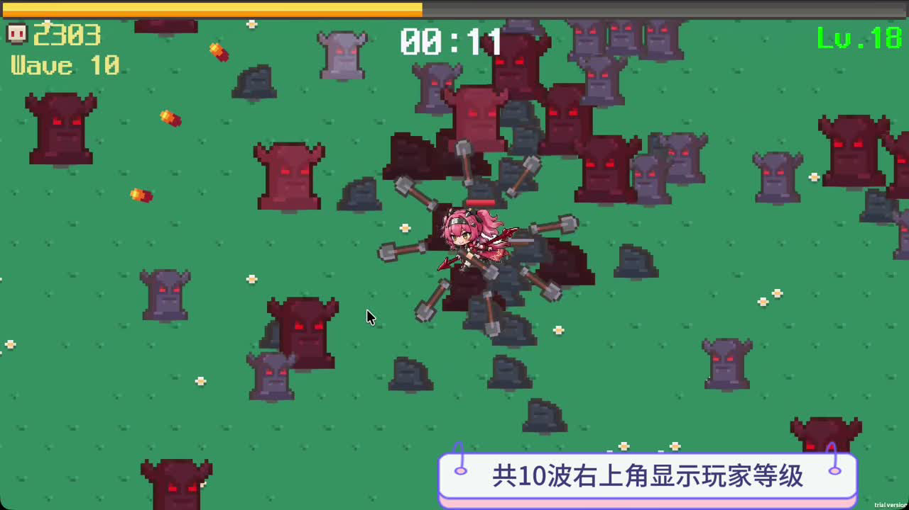
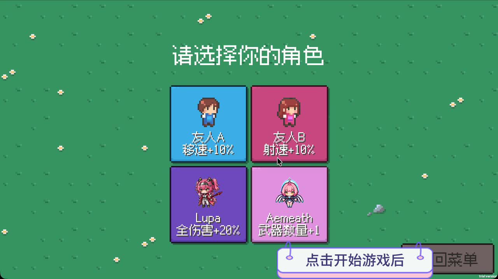
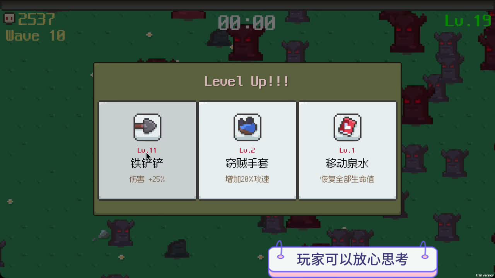

# Undead Survivor

一款使用 Unity 6 和 C# 独立完成的 2D 俯视角 Roguelike 生存游戏。玩家通过移动、走位和局内构筑应对持续增强的敌群，在五分钟内完成十个难度阶段即可获胜。



## 项目概览

| 项目 | 内容 |
| --- | --- |
| 开发方式 | 独立完成 |
| 项目性质 | 个人独立项目 |
| 开发时间 | 2026年2月至2026年6月 |
| 引擎 | Unity 6.3 `6000.3.10f1` |
| 语言 | C# |
| 类型 | 2D俯视角 Roguelike 生存游戏 |
| 单局时长 | 5分钟 |

我独立完成了玩法策划、程序实现、数值配置、生成式 AI 角色素材制作与动画配置、测试调优以及 macOS 版本打包。

## 演示与文档

- [约1分钟实机演示](docs/video/Undead_Survivor_Demo.mp4)
- [游戏设计与技术说明](docs/Undead_Survivor_Design_Document_CN.pdf)

## 核心玩法

1. 选择具有不同被动能力的角色。
2. 使用 WASD 移动，武器自动攻击附近敌人。
3. 击杀敌人获取经验，升级时从三个随机选项中选择强化。
4. 组合近战武器、远程武器、攻速、移速和治疗道具形成构筑。
5. 在逐步增强的敌群中存活五分钟。



## 主要系统

### 角色差异

- 速度型：移动速度和旋转武器速度提高 10%。
- 射速型：远程武器射击间隔缩短 10%。
- 力量型：全部伤害提高 20%。
- 多段型：弹体数量增加 1。

其中两个角色需要通过累计击杀或完成一局游戏解锁，状态通过 `PlayerPrefs` 保存。

### 战斗与成长

- 旋转近战武器持续攻击并具有无限穿透。
- 远程武器自动锁定最近目标，发射最多五发扇形弹幕。
- 20 级经验曲线，每级固定提高伤害、生命和恢复能力。
- 武器满级后仍可继续选择，每次获得 25% 伤害加成。
- 升级时暂停游戏，并随机展示三个不重复的选项。



### 难度控制

- 五分钟被划分为十个阶段，每阶段独立配置生成频率、敌人生命和移动速度。
- 阶段结束前五秒通过线性插值过渡到下一组参数。
- 精英敌人的出现概率随阶段提高，拥有三倍生命和三倍经验奖励。
- 系统每五秒读取玩家生命比例，在 `0.7` 至 `1.3` 范围内调整生成间隔。

### 工程实现

- `GameManager` 统一管理单局状态、生命、经验、暂停和结算。
- `PoolManager` 复用敌人与弹体，减少高频创建和销毁。
- `ScriptableObject` 管理武器与装备数据，分离参数和行为逻辑。
- 四块地图瓦片循环复用，形成无限地图效果。
- 最近目标扫描间隔为 0.1 秒，降低物理查询频率。
- 弹体具有五秒生命周期，扇形射击限制为最多五发。

```text
GameManager
├── Player and Character
├── Spawner and Enemy
├── Weapon Bullet and Scanner
├── Item Gear and LevelUp
├── PoolManager and Reposition
└── HUD Result Settings and Audio
```

## 运行项目

1. 安装 Unity Hub。
2. 使用 Unity `6000.3.10f1` 或兼容的 Unity 6 版本打开仓库根目录。
3. 等待 Package Manager 恢复依赖。
4. 打开 `Assets/Scenes/SampleScene.unity`。
5. 点击 Play 开始运行。

操作方式：

- `WASD` 或方向键：移动角色。
- `Esc`：暂停或打开设置。
- 攻击和索敌自动执行。

## 仓库结构

```text
Assets/
  Scenes/                    主游戏场景
  Undead Survivor/
    Codes/                   C# 游戏逻辑
    Data/                    ScriptableObject 数据
    Prefabs/                 玩家 敌人 武器与弹体预制体
    Animations/              角色和敌人动画
    Sprites/                 角色 敌人 UI 与地图素材
    Audio/                   音乐与音效
Packages/                    Unity 包依赖
ProjectSettings/             Unity 项目设置
docs/                        设计文档 截图与实机演示
```

## 素材与版权

本仓库的程序代码和项目设计均为独立完成。部分基础美术、音效和字体来自 GoldMetal 的 Undead Survivor 教程资源包；详细来源与使用说明见 [THIRD_PARTY_NOTICES.md](THIRD_PARTY_NOTICES.md)。角色序列帧包含使用生成式 AI 辅助制作的内容。

## 许可

本项目原创程序代码采用 [MIT License](LICENSE)。第三方美术、音效、字体及其他素材不属于 MIT 授权范围，仍遵循各自的原始许可，详见 [THIRD_PARTY_NOTICES.md](THIRD_PARTY_NOTICES.md)。

